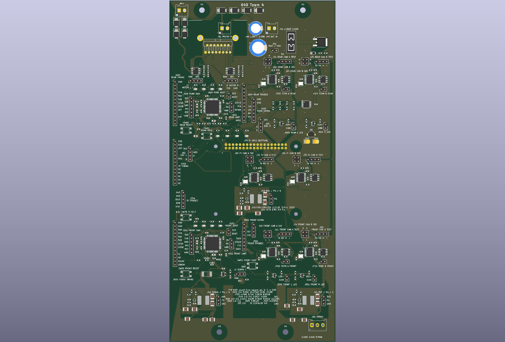
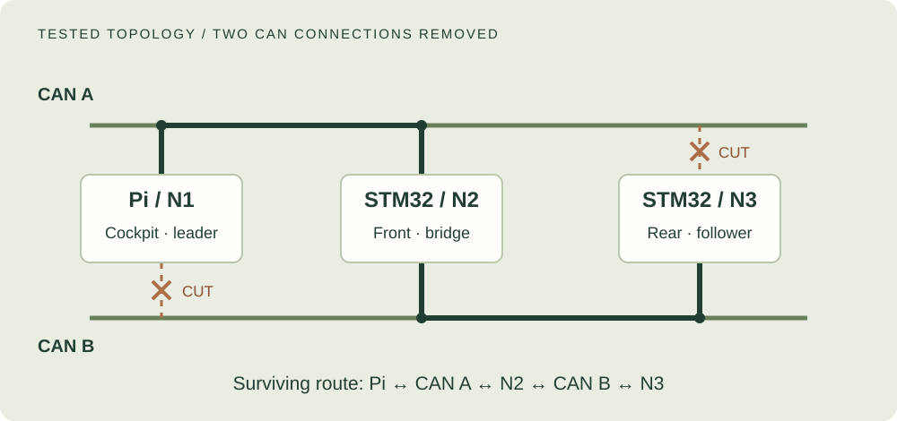
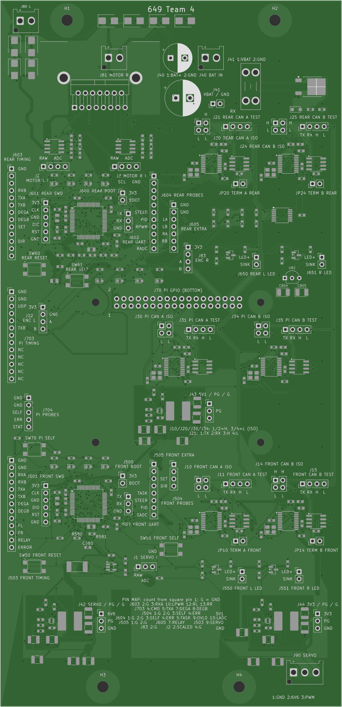

<a class="back-link" href="index.html#projects">← All projects</a>

<section class="case-hero shell can-hero">
  

CMU 18-649 / Distributed embedded systems
<h1>Drive-by-wire over redundant CAN</h1>
Our three-person team built an automotive prototype with a Raspberry Pi cockpit and two STM32 control zones. My focus is firmware integration, CAN fault diagnosis and automated tests; I also designed the four-layer controller PCB.

C / ZephyrSTM32F4Raspberry Pi / LinuxDual CANKiCad

  <figure class="can-board-figure"><figcaption>Controller PCB · KiCad render Design artifact, not a photo of assembled hardware. <a href="assets/automotive-can/pcb-top.png">Open full image ↗</a></figcaption></figure>
</section>
<section class="case-overview shell" aria-label="Project at a glance">

Context

Fall 2026 · Three-person team Automotive controls course project

My contribution

Integration, fault diagnosis & tests PCB schematic and layout

Status

Working Lab 5 bench baseline Further validation in progress

</section>

<section class="project-overview shell" aria-labelledby="route-title">
  
<h2 id="route-title">Keeping a path when links fail</h2>
Normal operation connects all three nodes to both CAN buses. This test removed one connection at each end.

  <figure class="can-route-figure"><figcaption>High-level diagram of the tested Pi-led route. The Windows wheel/pedal proxy sends UDP commands to the Pi; N2 bridges the surviving CAN segments.</figcaption></figure>
  

<strong>3</strong>
Nodes in the control system

<strong>2</strong>
CAN connections removed in the test

<strong>3,566</strong>
Matching saved entries on all three nodes

<strong>4 layers</strong>
Controller PCB design

</section>

<aside class="case-nav" aria-label="On this page">
In this case study
<a href="#contribution">01 / My contribution</a><a href="#pcb">02 / Controller PCB</a><a href="#diagnosis">03 / Diagnosing faults</a><a href="#verification">04 / Hardware evidence</a></aside>

<section id="contribution">
01 / My contribution
<h2>Connecting firmware, hardware and evidence</h2>
I co-developed the prototype firmware and coordinated matching Pi/Nucleo configurations. I exercised normal wheel/pedal inputs and CAN disconnections, captured traffic, and traced reception, validation and forwarding to diagnose failures.

I used automated host tests alongside bench captures to check protocol changes. The team is extending the system with Raft leader election, persistent replicated event logs and CAN-based clock synchronization. Teammates led the oscilloscope timing measurements and other consensus checks.

This page focuses on my integration and PCB work, and identifies the results we verified together.
</section>

<section id="pcb">
02 / Controller PCB
<h2>From a wired prototype to one board</h2>
I designed the schematic and four-layer KiCad layout to consolidate two STM32 MCUs, six CAN interfaces, motor/servo control, current sensing and power regulation. The layout also provides a Raspberry Pi interface, programming headers, test points and accessible isolation jumpers.

01
<strong>Motor and battery connections</strong> Driver, power input and motor interfaces at the top.

02
<strong>Rear control zone</strong> STM32, two CAN interfaces and diagnostic access.

03
<strong>Pi interface</strong> GPIO connection and the cockpit's two CAN interfaces.

04
<strong>Front control and supplies</strong> STM32, CAN, servo connection and regulated rails.

I reconciled mounting locations with our chassis measurements and fit checks, reviewed connector access and copper clearances, and generated schematic, layout and fabrication exports for review.

View the PCB layout +
<figure class="can-layout-image"><figcaption>Top-side fabrication preview from the November 2 review package. Select the image for detail.</figcaption></figure>

The render uses available component models; some custom parts are omitted. Lab 5 hardware results below used Nucleo boards and CAN modules. They do not establish that the custom PCB has been assembled or electrically validated.
</section>

<section id="diagnosis">
03 / Diagnosing faults
<h2>A brief flash needed an explanation</h2>
While establishing the two-cut route, the rear blinkers briefly entered hazards while the front pair did not. I compared both Nucleo logs with Pi events and CAN captures. The rear node had entered a local error state while the front node remained healthy; clock synchronization alone could not make different output modes match.

Further analysis found full CAN transmit buffers on the Pi's still-connected bus. The software follow-up added bounded retries independently for each bus and more detailed health logging. That change passed host tests and firmware builds; its hardware follow-up remains open.

<h3>Keep the requirement while diagnosing the failure</h3>
We kept the 100 ms stale-input timeout unchanged. I separated network arrival timing, application processing and protocol state instead of increasing the timeout to hide brief errors.

</section>

<section id="verification">
04 / Hardware evidence
<h2>What the bench tests established</h2>
The November 10, 2026 session established a working functional baseline on the Pi and both Nucleos.

<table><caption>Selected results from retained CAN, serial and event-history records</caption><thead><tr><th scope="col">Check</th><th scope="col">Observed result</th></tr></thead><tbody><tr><th scope="row">Normal controls</th><td>Wheel/pedal values responded; left, right and cancel controlled the corresponding front/rear blinkers.</td></tr><tr><th scope="row">Pi-led two-cut route</th><td>Control values and both turn signals worked through N2 while Pi CAN B and N3 CAN A were disconnected.</td></tr><tr><th scope="row">Replicated event</th><td>An N2 diagnostic event reached all three saved histories during the Pi-led test.</td></tr><tr><th scope="row">History agreement</th><td>All three exports matched for entries 1–3,566, comparing index, term and event.</td></tr></tbody></table>

The settled route worked; brief errors occurred during transitions. Physical timing limits, remaining failure/replay cases and the later software correction still need validation. This is a course prototype, not a production automotive system.

These images and the architecture diagram can be opened at full size. Course solution code, complete schematics, raw logs and fabrication ZIPs are not distributed on this portfolio.
</section>

<section class="next-project shell">
Related project / Embedded control
<a href="stm32_freertos.html"><h2>STM32 firmware &amp; motor control</h2>↗</a>
Device drivers, board bring-up and a FreeRTOS PID controller.
</section>
