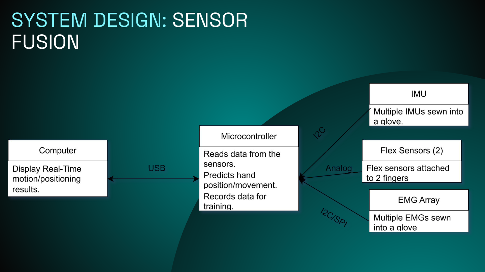
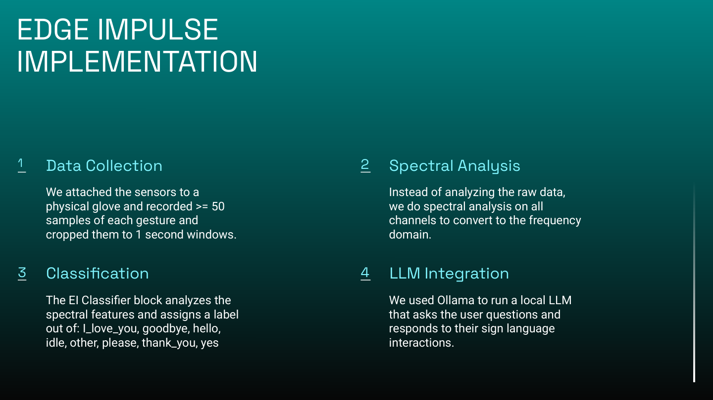
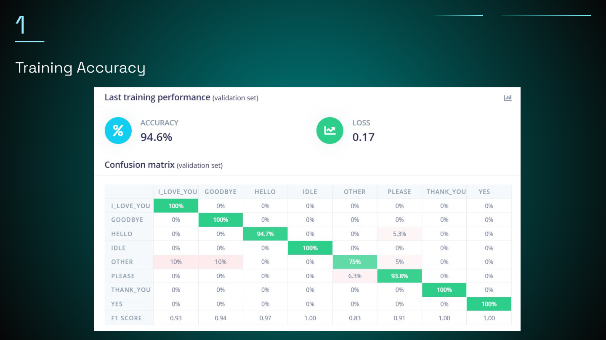

[All projects](./)

Our Embedded Machine Learning team built a wearable prototype to classify a small set of gestures from biosignals and motion. I wrote C firmware, integrated sensors, collected data, trained and evaluated an Edge Impulse model, deployed it to the device, and documented calibration procedures.

The project explores a camera-free input method for assistive communication. It is a limited-vocabulary prototype, not a general sign-language translator.

## System and my contribution

The class prototype used an **ESP32-S3**, EMG, an IMU, a magnetometer, and flex sensors. My work connected sensor acquisition through analog inputs and I²C to the data-collection and embedded inference workflow.

## Firmware and inference

The documented pipeline samples sensor channels at **100 Hz**, forms **1,000 ms windows**, and advances by a **300 ms stride**. An Edge Impulse model classifies each window, with confidence gating and a cooldown to reduce ambiguous or repeated outputs.

The gesture labels are `I_LOVE_YOU`, `GOODBYE`, `HELLO`, `PLEASE`, `THANK_YOU`, and `YES`, alongside `IDLE` and `OTHER`. `UNCERTAIN` is an abstention output when confidence is insufficient.

A one-second input window and model computation time are different parts of the response time. I do not report a measured end-to-end latency for the complete system here.

## Class-demo results

| Evaluation | Reported result |
| --- | --- |
| Validation accuracy | 94.6% |
| Validation loss | 0.17 |
| Test accuracy | 93.06% |

These are the results shown in the class-demo slides below. They apply to that model and dataset; they do not demonstrate accuracy across new users or later hardware revisions.

The `OTHER` category and ambiguous gestures account for several of the errors. The test matrix also shows abstentions. That makes confidence handling part of the interface behavior, rather than just an overall accuracy number.

[View the class-demo slides](assets/glove/Demo.pdf)

## Later hardware revision

After the class project, I revised the sensing setup to remove the flex sensors and use an external **MMC5983MA magnetometer**. The revised hardware includes:

- Seeed XIAO ESP32-S3.
- Grove EMG Detector with an ADS1115 I²C ADC.
- MPU-9255 accelerometer and gyroscope.
- MMC5983MA magnetometer in place of the IMU's internal magnetometer.

The diagrams and evaluation screenshots above describe the class version, which included flex sensors. I have not published a new accuracy evaluation for the revised sensor set on this page.

## Limitations and next steps

EMG changes with electrode placement and between sessions, and movement can introduce noise. Magnetic disturbances also affect orientation measurements. Expanding the vocabulary and exploring phrase-level output are further work, not demonstrated capabilities of the class prototype.

The next useful evaluation would separate training and testing across sessions and users, then report per-class precision and recall as well as complete-system latency. Source code is not publicly accessible through this portfolio; the demo slides and diagrams are the available artifacts.
