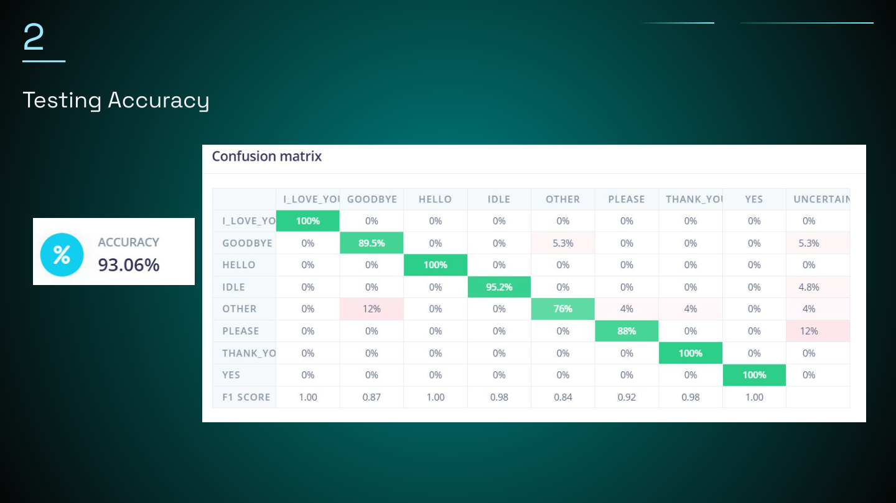
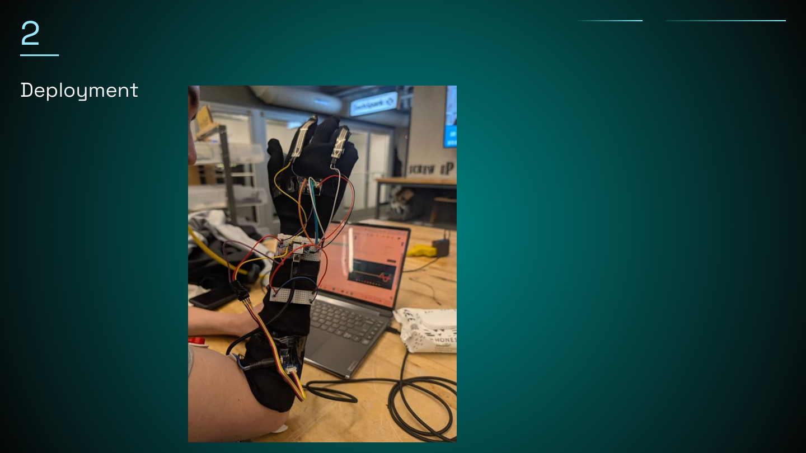

<a class="back-link" href="index.html#projects">← All projects</a>

<section class="case-hero shell photo-hero">

Case study 05 / Embedded machine learning
<h1>Gesture-classification glove</h1>
Our team built a wearable prototype to classify a small set of gestures. I worked on C firmware, sensor integration, data collection, model training and evaluation, and deployment to the device.

CESP32-S3EMG &amp; motion sensingEdge Impulse

<figure class="case-picture prototype-photo"><figcaption>Class-demo prototype · original sensor configuration</figcaption></figure></section>
<section class="case-overview shell" aria-label="Project at a glance">

Context

Embedded Machine Learning Team course project

My contribution

Firmware, sensors, data collection, model training, evaluation, and deployment

Scope

Limited gesture vocabulary Class results and later hardware kept separate

</section>
<section class="project-overview shell" aria-labelledby="inference-title">

Class-version pipeline
<h2 id="inference-title">From sensor samples to gesture output</h2>

Sample<h3>100 Hz</h3>
Sensor channels

→
Window<h3>1,000 ms</h3>
300 ms stride

→
Classify<h3>On-device inference</h3>
Confidence gating and cooldown

The window duration is one part of response time. Complete-system latency is not reported here.
</section>

<aside class="case-nav" aria-label="On this page">
In this case study
<a href="#section-1">01 / Sensors and my contribution</a><a href="#section-2">02 / Firmware and inference</a><a href="#section-3">03 / Class-demo results</a><a href="#section-4">04 / Later hardware revision</a><a href="#section-5">05 / Limitations and next steps</a></aside>
<section id="section-1">
01 / Embedded machine learning
<h2>Sensors and my contribution</h2>
The project explores a camera-free input method for assistive communication. It is a limited-vocabulary prototype, not a general sign-language translator.

The class prototype used an <strong>ESP32-S3</strong>, EMG, an IMU, a magnetometer, and flex sensors. My work connected sensor acquisition through analog inputs and I²C to the data-collection and embedded inference workflow.

Class-demo system design and sensor inputs+

<figure class="case-picture "><figcaption>Class-demo slide · original sensor configuration</figcaption></figure>

Edge Impulse workflow used in the class project+

<figure class="case-picture "><figcaption>Class-demo slide · original sensor configuration</figcaption></figure>

I also documented calibration procedures for the prototype.
</section>
<section id="section-2">
02 / Embedded machine learning
<h2>Firmware and inference</h2>
The documented pipeline samples sensor channels at <strong>100 Hz</strong>, forms <strong>1,000 ms windows</strong>, and advances by a <strong>300 ms stride</strong>. An Edge Impulse model classifies each window, with confidence gating and a cooldown to reduce ambiguous or repeated outputs.

The gesture labels are <code>I_LOVE_YOU</code>, <code>GOODBYE</code>, <code>HELLO</code>, <code>PLEASE</code>, <code>THANK_YOU</code>, and <code>YES</code>, alongside <code>IDLE</code> and <code>OTHER</code>. <code>UNCERTAIN</code> is an abstention output when confidence is insufficient.

A one-second input window and model computation time are different parts of the response time. I do not report a measured end-to-end latency for the complete system here.

</section>
<section id="section-3">
03 / Embedded machine learning
<h2>Class-demo results</h2>
<table>
<thead>
<tr>
<th>Evaluation</th>
<th>Reported result</th>
</tr>
</thead>
<tbody><tr>
<td>Validation accuracy</td>
<td>94.6%</td>
</tr>
<tr>
<td>Validation loss</td>
<td>0.17</td>
</tr>
<tr>
<td>Test accuracy</td>
<td>93.06%</td>
</tr>
</tbody></table>

These are the results shown in the class-demo slides below. They apply to that model and dataset; they do not demonstrate accuracy across new users or later hardware revisions.

Validation accuracy, loss, and per-class confusion matrix+

<figure class="case-picture "><figcaption>Class-demo slide · original sensor configuration</figcaption></figure>

Test accuracy and confusion matrix, including uncertain outputs+

<figure class="case-picture "><figcaption>Class-demo slide · original sensor configuration</figcaption></figure>

The <code>OTHER</code> category and ambiguous gestures account for several of the errors. The test matrix also shows abstentions. That makes confidence handling part of the interface behavior, rather than just an overall accuracy number.

Class prototype deployed on a glove+

<figure class="case-picture "><figcaption>Class-demo slide · original sensor configuration</figcaption></figure>

<a href="assets/glove/Demo.pdf">View the class-demo slides</a>

</section>
<section id="section-4">
04 / Embedded machine learning
<h2>Later hardware revision</h2>
After the class project, I revised the sensing setup to remove the flex sensors and use an external <strong>MMC5983MA magnetometer</strong>. The revised hardware includes:

<ul>
<li>Seeed XIAO ESP32-S3.</li>
<li>Grove EMG Detector with an ADS1115 I²C ADC.</li>
<li>MPU-9255 accelerometer and gyroscope.</li>
<li>MMC5983MA magnetometer in place of the IMU&#39;s internal magnetometer.</li>
</ul>

The diagrams and evaluation screenshots above describe the class version, which included flex sensors. I have not published a new accuracy evaluation for the revised sensor set on this page.

</section>
<section id="section-5">
05 / Embedded machine learning
<h2>Limitations and next steps</h2>
EMG changes with electrode placement and between sessions, and movement can introduce noise. Magnetic disturbances also affect orientation measurements. Expanding the vocabulary and exploring phrase-level output are further work, not demonstrated capabilities of the class prototype.

The next useful evaluation would separate training and testing across sessions and users, then report per-class precision and recall as well as complete-system latency. Source code is not publicly accessible through this portfolio; the demo slides and diagrams are the available artifacts.

</section>

<section class="next-project shell">
Next project
<a href="postpartum_health.html"><h2>Environmental sensing for home health</h2>↗</a>
Wi-Fi data collection, a Raspberry Pi receiver, and DynamoDB logging.
</section>
