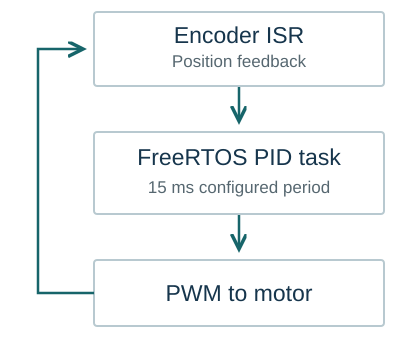

I am an M.S. student in Electrical and Computer Engineering at Carnegie Mellon, completing my program in **May 2027**. I work mainly in **C**, with Python for testing and data collection.

I like working on problems where building a useful physical system can make a real difference. These pages explain what I contributed, how I tested it, and what still needs work.

<section class="project-list" aria-labelledby="selected-projects">
  <h2 id="selected-projects">Selected projects</h2>

  <article class="project">
    

      <h3><a href="esab.html">Medical-gas pipeline monitoring</a></h3>
      
Sensor systems · Requirements and design · Hardware testing

      
Research with CMU’s Biorobotics Lab and ESAB. I contribute to firmware, sensor evaluation, board design, and a medical-gas testbed; the project page is a high-level summary because the implementation is confidential.

    

  </article>

  <article class="project">
    

      <h3><a href="resp_ecmo_monitoring.html">TeleLine: gas-flow sensing and data acquisition</a></h3>
      
C · PSoC 5LP · USB serial · Python · Bench testing

      
I replaced delay loops with hardware timers and built telemetry and test tools to make sampling more repeatable. The project page connects those changes to timing checks and reference-instrument testing.

    

  </article>

  <article class="project project-with-preview">
    

      <h3><a href="stm32_freertos.html">STM32 firmware, PCB bring-up, and motor control</a></h3>
      
C · Device drivers · PCB layout · FreeRTOS

      
I laid out and brought up a board from a course-provided schematic, then wrote its bare-metal and RTOS firmware. A motor controller brought the drivers, encoder feedback, and task timing together.

    

    <figure class="project-preview">
      
      <figcaption>Motor-control loop</figcaption>
    </figure>
  </article>

  <article class="project">
    

      <h3><a href="embedded_real_time_systems.html">Embedded Linux and real-time scheduling</a></h3>
      
C · Linux kernel modules · System calls · Execution tracing

      
I built applications and kernel components on Raspberry Pi 4 for periodic-task monitoring and scheduling experiments, then used execution traces to investigate their behavior.

    

  </article>

  <article class="project project-with-preview">
    

      <h3><a href="glove.html">Gesture-classification glove</a></h3>
      
C · ESP32-S3 · EMG and motion sensors · Edge Impulse

      
Our team built a wearable prototype that recognizes a small set of gestures on the device. I contributed firmware, sensor integration, data collection, model training, and deployment.

    

    <figure class="project-preview glove-preview">
      
      <figcaption>Our class-demo prototype</figcaption>
    </figure>
  </article>

  <article class="project">
    

      <h3><a href="postpartum_health.html">Environmental sensing for a home-health prototype</a></h3>
      
Python · Raspberry Pi · Wi-Fi and HTTP · AWS DynamoDB

      
Our team used decision matrices to compare controllers, sensors, and communication options. I worked on environmental hardware and firmware, including the Pi receiver and cloud-logging path.

    

  </article>
</section>

Team contributions and sharing limits are identified on each project page.

