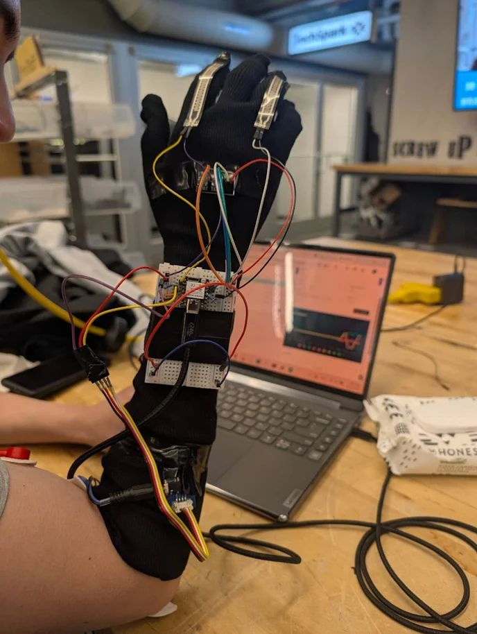

<section class="home-intro shell">
  
Carnegie Mellon University · M.S. ECE · May 2027

  

    <h1>Embedded firmware &amp; hardware bring-up</h1>
    
I work mainly in C and Python, developing device drivers, integrating sensors, and testing hardware and firmware together.

  

</section>

<section class="home-projects shell" id="projects" aria-labelledby="work-title">
  
  
<h2 id="work-title">Projects</h2>
My contributions, implementation details, and how I tested the work.

  

    <a class="gallery-project" href="automotive_can.html">
      

        Controller PCB
        

        KiCad render · design artifact
      

      

        
CMU 18-649 · Team project

        
<h3>Drive-by-wire over redundant CAN</h3>↗

        
My work on a three-person automotive prototype: firmware integration, CAN fault diagnosis, automated tests and a four-layer PCB design.

        
C / Zephyr · STM32 + Pi · CAN / Raft · KiCad

      

    </a>
    <a class="gallery-project" href="esab.html">
      

        Areas of contribution
        

          
<svg viewBox="0 0 48 48" aria-hidden="true"><rect x="12" y="12" width="24" height="24" rx="3"/><path d="M18 12V6m12 6V6M18 36v6m12-6v6M12 18H6m6 12H6m30-12h6m-6 12h6"/><path d="m22 19-5 5 5 5m4-10 5 5-5 5"/></svg>Sensor firmware

          
<svg viewBox="0 0 48 48" aria-hidden="true"><rect x="8" y="8" width="32" height="32" rx="3"/><rect x="15" y="14" width="12" height="12" rx="1"/><path d="M27 19h7v14H18v-7M8 32h10"/><circle cx="34" cy="14" r="1.5"/><circle cx="14" cy="33" r="1.5"/></svg>Hardware integration

          
<svg viewBox="0 0 48 48" aria-hidden="true"><rect x="6" y="9" width="36" height="25" rx="3"/><path d="M11 24h7l4-9 5 14 3-8h7M18 40h12M24 34v6"/></svg>Testbed development

        

        Public research summary
      

      

        
CMU Biorobotics Lab × ESAB

        
<h3>Medical-gas pipeline monitoring</h3>↗

        
I contributed to firmware, sensor evaluation, board design, and a medical-gas testbed. This is a high-level summary because implementation details are confidential.

        
Sensor systems · PCB design · Hardware testing

      

    </a>
    <a class="gallery-project" href="resp_ecmo_monitoring.html">
      

        Sampling &amp; data acquisition
        

          
SDP pressureBME
→
          
<strong>PSoC 5LP</strong>Hardware timers
→
          
<strong>Python</strong>Logs &amp; tests

        

        Timer-driven sampling → USB telemetry → inspection
      

      

        
CMU Biorobotics Lab

        
<h3>TeleLine: gas-flow sensing</h3>↗

        
I replaced delay loops with hardware timers and built telemetry and test tools to make sampling more repeatable.

        
C · PSoC 5LP · USB serial · Python

      

    </a>
    <a class="gallery-project" href="embedded_real_time_systems.html">
      

        Raspberry Pi 4 / Linux
        

          
User space<strong>Periodic C workloads</strong>

          
Kernel space<strong>Modules &amp; system calls</strong>

          
Analysis<strong>trace-cmd / KernelShark</strong>

        

        Workloads, kernel interfaces &amp; execution traces
      

      

        
CMU coursework

        
<h3>Embedded Linux &amp; real-time scheduling</h3>↗

        
I built applications and kernel components on Raspberry Pi 4 for periodic-task monitoring and scheduling experiments, then used execution traces to investigate their behavior.

        
C · Linux kernel modules · System calls · Execution tracing

      

    </a>
    <a class="gallery-project" href="glove.html">
      

        
        
Sensor inputs<i>↓</i><strong>ESP32-S3</strong><i>↓</i>On-device classification

        Team prototype
      

      

        
Team course project

        
<h3>Gesture-classification glove</h3>↗

        
Our team built a wearable prototype that recognizes a small set of gestures on the device. I contributed firmware, sensor integration, data collection, model training, and deployment.

        
C · ESP32-S3 · EMG and motion sensors · Edge Impulse

      

    </a>
    <a class="gallery-project" href="postpartum_health.html">
      

        PM / gas sensing path
        

          
<svg viewBox="0 0 48 48" aria-hidden="true"><rect x="10" y="8" width="28" height="32" rx="3"/><rect x="17" y="17" width="14" height="14"/><path d="M6 15h4m-4 9h4m-4 9h4m28-18h4m-4 9h4m-4 9h4"/></svg><strong>Pico 2 W</strong>Sensor node

          →
          
<svg viewBox="0 0 48 48" aria-hidden="true"><rect x="8" y="10" width="32" height="28" rx="3"/><path d="M14 17h20M14 24h20M14 31h10"/></svg><strong>Pi 5</strong>HTTP receiver

          →
          
<svg viewBox="0 0 48 48" aria-hidden="true"><ellipse cx="24" cy="12" rx="15" ry="6"/><path d="M9 12v23c0 8 30 8 30 0V12M9 24c0 8 30 8 30 0"/></svg><strong>DynamoDB</strong>Records

        

        Sensor node → base station → cloud storage
      

      

        
Team course project

        
<h3>Environmental sensing for home health</h3>↗

        
Our team used decision matrices to compare controllers, sensors, and communication options. I worked on environmental hardware and firmware, including the Pi receiver and cloud-logging path.

        
Python · Raspberry Pi · Wi-Fi / HTTP · DynamoDB

      

    </a>
    <a class="gallery-project" href="stm32_freertos.html">
      

        Position control / STM32
        
      

      

        
CMU coursework

        
<h3>STM32 firmware &amp; motor control</h3>↗

        
I laid out and brought up a board from a course-provided schematic, then wrote its bare-metal and FreeRTOS firmware for motor control.

        
C · Device drivers · PCB layout · FreeRTOS

      

    </a>
  

</section>
<section class="home-about shell" id="about" aria-labelledby="about-title">
  
  <h2 id="about-title">About me</h2>
  

I’m an M.S. student in Electrical and Computer Engineering at Carnegie Mellon, completing my program in May 2027. I mainly work in C and Python.

I like working on problems where building a useful physical system can make a real difference. Here, I explain what I contributed, how I tested it, and what still needs work.
<a class="text-link" href="mailto:hetianyi74@gmail.com">Contact me ↗</a>

</section>

