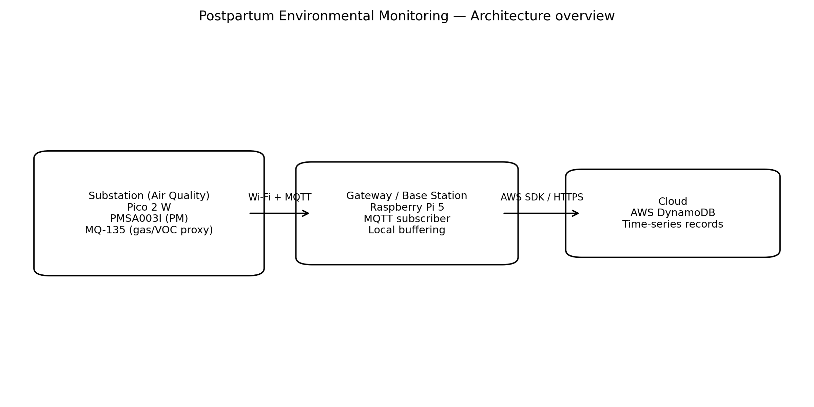
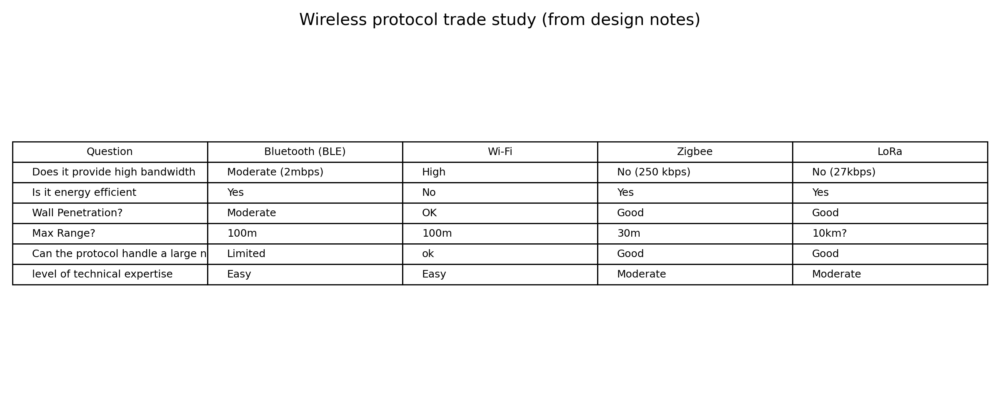
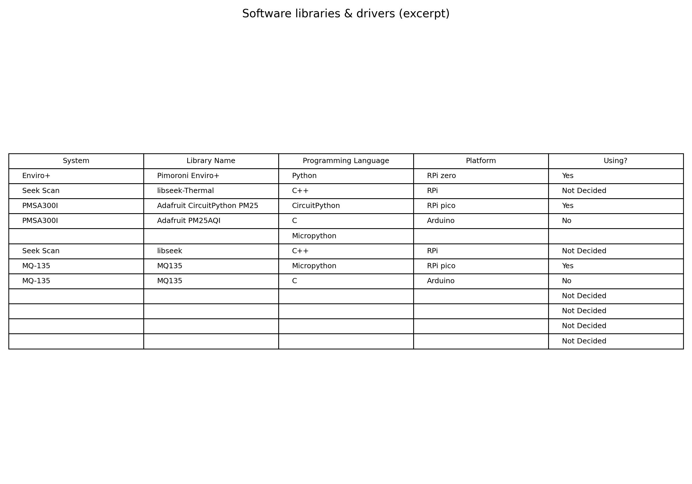

<a class="back-link" href="index.html#projects">← All projects</a>

<section class="case-hero shell ">

Case study 06 / Prototyping
<h1>Environmental sensing for home health</h1>
In the Fourth Trimester Health team project, I worked on environmental hardware and firmware. Our subsystem sent air-quality readings through a Raspberry Pi base station to cloud storage.

PythonPico 2 WRaspberry Pi 5Wi-Fi / HTTPDynamoDB

<a class="button primary" href="https://github.com/CMU-RPCS-2025/Environmental_HW_FW/tree/tianyi_PMCO2_wifi_cloud">View my implementation ↗</a><a class="text-link" href="https://github.com/CMU-RPCS-2025/Environmental_HW_FW">Team repository ↗</a>

</section>
<section class="case-overview shell" aria-label="Project at a glance">

Context

Fourth Trimester Health Team course prototype

My contribution

Environmental hardware and firmware PM/gas receiver and cloud-logging path

Scope

Prototype data collection No clinical or gas-accuracy validation claimed

</section>
<section class="project-overview shell" aria-labelledby="environment-path">

PM/gas implementation
<h2 id="environment-path">Sensor node to cloud storage</h2>

Sensor node<h3>Pico 2 W</h3>
PMSA003I + MQ-135

→
Wi-Fi / HTTP<h3>Raspberry Pi 5</h3>
Flask receiver

→
Periodic upload<h3>DynamoDB</h3>
Timestamped records

The separate Enviro+ implementation uses MQTT. The paths are not interchangeable.
</section>

<aside class="case-nav" aria-label="On this page">
In this case study
<a href="#section-1">01 / System and my contribution</a><a href="#section-2">02 / Choosing the hardware</a><a href="#section-3">03 / Communication and storage</a><a href="#section-4">04 / What the implementation establishes</a><a href="#section-5">05 / Design artifacts</a></aside>
<section id="section-1">
01 / Prototyping
<h2>System and my contribution</h2>
Our broader team built a base station and several sensing substations. I contributed to the environmental hardware and firmware workstream, including the Wi-Fi receiver and cloud-logging path for the PM/gas node.

<figure class="case-picture "><figcaption>Team design artifact</figcaption></figure>

The environmental work included a <strong>Pico 2 W</strong> node with a <strong>PMSA003I particulate sensor</strong> and an <strong>MQ-135 gas sensor</strong>, plus a separate <strong>Enviro+</strong> approach for ambient measurements. A <strong>Raspberry Pi 5</strong> served as the base station.

</section>
<section id="section-2">
02 / Prototyping
<h2>Choosing the hardware</h2>
We used decision matrices to compare MCUs, sensors, and communication options before selecting components. The base station and sensing nodes had different needs, so we compared them separately instead of looking for one board to do everything.

<ul>
<li><strong>Controllers:</strong> programming support, cost, wireless connectivity, power, memory, form factor, and sensor interfaces.</li>
<li><strong>Sensors:</strong> what each device could measure, its stated range, and its calibration needs.</li>
<li><strong>Wireless links:</strong> bandwidth, energy use, range, support for multiple devices, and implementation effort.</li>
</ul>

The matrices made those tradeoffs explicit and gave the team a common basis for the component decisions. They were working design notes, not bench measurements.

<a href="assets/postpartum/design_matrices.xlsx">View the MCU, sensor, and wireless decision matrices</a>

</section>
<section id="section-3">
03 / Prototyping
<h2>Communication and storage</h2>
The PM/gas implementation sends readings over Wi-Fi to a Flask HTTP endpoint on the Pi. My receiver stores the latest PM and gas readings, then periodically combines them into a timestamped DynamoDB record once both are available. The Enviro+ path uses MQTT; it is a separate implementation within the team&#39;s system.

<figure class="case-picture "><figcaption>Team design artifact</figcaption></figure>

The table uses a <code>device_id</code> partition key and a <code>timestamp</code> sort key. The receiver preserves particulate counts, PM concentration fields, gas-sensor values, and calibration-related fields, converting numeric values to the types expected by DynamoDB.

</section>
<section id="section-4">
04 / Prototyping
<h2>What the implementation establishes</h2>
The public branch shows the HTTP receiver and periodic upload loop. It waits for both sensor groups before uploading and logs upload failures. The current design combines each sensor&#39;s latest value; it does not establish synchronized acquisition. It also does not implement durable buffering or automatic replay of failed uploads.

The MQ-135 output and calibration fields should not be treated as a validated selective CO₂ measurement. The portfolio does not claim a reference-verified gas-concentration accuracy.

</section>
<section id="section-5">
05 / Prototyping
<h2>Design artifacts</h2>

Component planning, software inventory, and sensor comparison+

The team used architecture diagrams, component comparisons, procurement planning, and a software inventory to work through the sensing and integration choices.

<h3>Component planning</h3>
<figure class="case-picture "><figcaption>Team design artifact</figcaption></figure>

<a href="assets/postpartum/procurement_list.xlsx">Procurement workbook</a>

<h3>Software and drivers</h3>
<figure class="case-picture "><figcaption>Team design artifact</figcaption></figure>

<a href="assets/postpartum/software_libraries.xlsx">Software inventory workbook</a>

<h3>Sensor comparison</h3>
<figure class="case-picture "><figcaption>Team design artifact</figcaption></figure>

<a href="assets/postpartum/design_matrices.xlsx">Design matrices</a> · <a href="assets/postpartum/topology_mqtt.drawio">Editable system topology</a> · <a href="assets/postpartum/pico_wiring_pm_mq135.drawio">PM/gas wiring diagram</a>

The trade studies and diagrams record the team&#39;s design work. The linked branch is the reference for the PM/gas receiver&#39;s implemented behavior.

</section>

<section class="next-project shell">
Next project
<a href="stm32_freertos.html"><h2>STM32 firmware & motor control</h2>↗</a>
PCB layout, board bring-up, C drivers, and FreeRTOS motor control.
</section>
