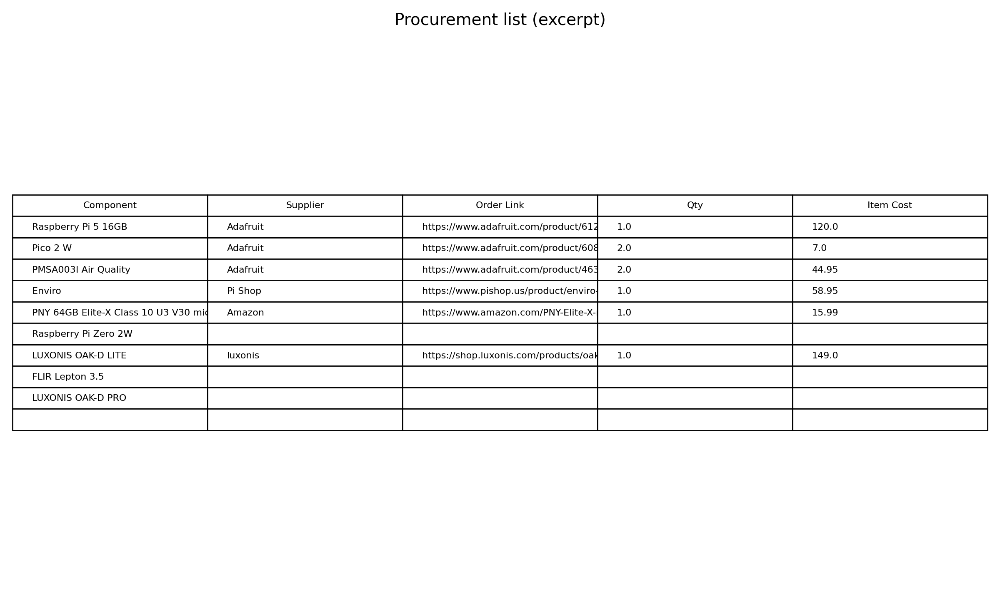
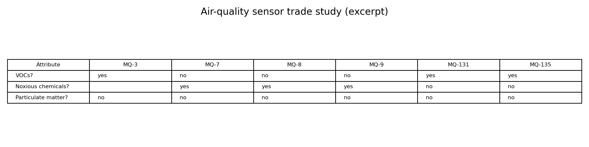

[All projects](./)

In the Fourth Trimester Health team project, I worked on environmental hardware and firmware for a home-health monitoring concept. Our subsystem collected air-quality readings and sent them through a Raspberry Pi base station to cloud storage. It was a course prototype, not a clinically validated monitoring device.

[Team repository](https://github.com/CMU-RPCS-2025/Environmental_HW_FW) · [My PM/gas receiver and cloud-logging branch](https://github.com/CMU-RPCS-2025/Environmental_HW_FW/tree/tianyi_PMCO2_wifi_cloud)

## System and my contribution

Our broader team built a base station and several sensing substations. I contributed to the environmental hardware and firmware workstream, including the Wi-Fi receiver and cloud-logging path for the PM/gas node.

The environmental work included a **Pico 2 W** node with a **PMSA003I particulate sensor** and an **MQ-135 gas sensor**, plus a separate **Enviro+** approach for ambient measurements. A **Raspberry Pi 5** served as the base station.

## Choosing the hardware

We used decision matrices to compare MCUs, sensors, and communication options before selecting components. The base station and sensing nodes had different needs, so we compared them separately instead of looking for one board to do everything.

- **Controllers:** programming support, cost, wireless connectivity, power, memory, form factor, and sensor interfaces.
- **Sensors:** what each device could measure, its stated range, and its calibration needs.
- **Wireless links:** bandwidth, energy use, range, support for multiple devices, and implementation effort.

The matrices made those tradeoffs explicit and gave the team a common basis for the component decisions. They were working design notes, not bench measurements.

[View the MCU, sensor, and wireless decision matrices](assets/postpartum/design_matrices.xlsx)

## Communication and storage

The PM/gas implementation sends readings over Wi-Fi to a Flask HTTP endpoint on the Pi. My receiver stores the latest PM and gas readings, then periodically combines them into a timestamped DynamoDB record once both are available. The Enviro+ path uses MQTT; it is a separate implementation within the team's system.

The table uses a `device_id` partition key and a `timestamp` sort key. The receiver preserves particulate counts, PM concentration fields, gas-sensor values, and calibration-related fields, converting numeric values to the types expected by DynamoDB.

## What the implementation establishes

The public branch shows the HTTP receiver and periodic upload loop. It waits for both sensor groups before uploading and logs upload failures. The current design combines each sensor's latest value; it does not establish synchronized acquisition. It also does not implement durable buffering or automatic replay of failed uploads.

The MQ-135 output and calibration fields should not be treated as a validated selective CO₂ measurement. The portfolio does not claim a reference-verified gas-concentration accuracy.

## Design artifacts

The team used architecture diagrams, component comparisons, procurement planning, and a software inventory to work through the sensing and integration choices.

### Component planning

[Procurement workbook](assets/postpartum/procurement_list.xlsx)

### Software and drivers

[Software inventory workbook](assets/postpartum/software_libraries.xlsx)

### Sensor comparison

[Design matrices](assets/postpartum/design_matrices.xlsx) · [Editable system topology](assets/postpartum/topology_mqtt.drawio) · [PM/gas wiring diagram](assets/postpartum/pico_wiring_pm_mq135.drawio)

The trade studies and diagrams record the team's design work. The linked branch is the reference for the PM/gas receiver's implemented behavior.
