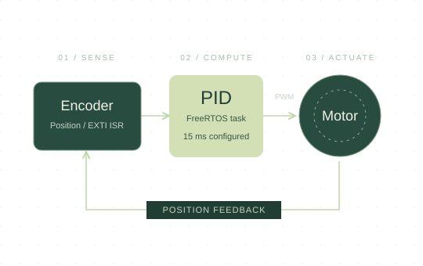
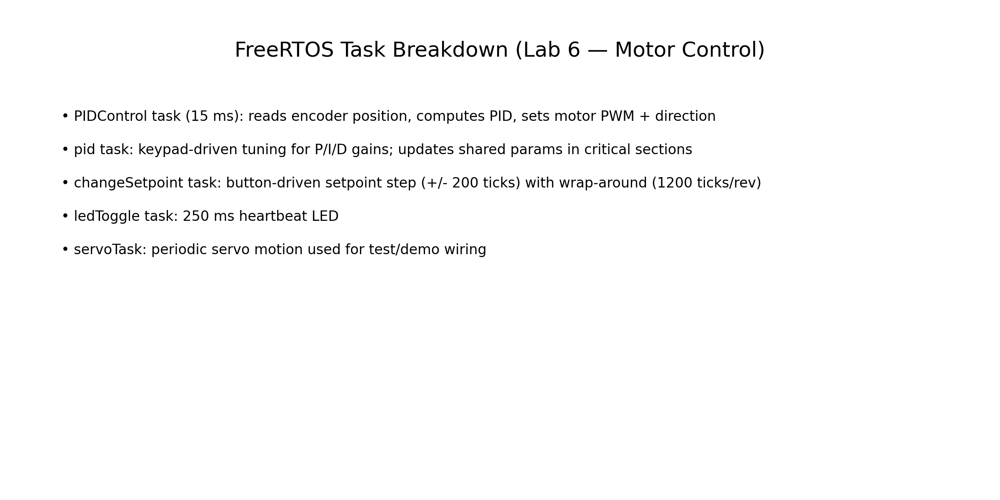

<a class="back-link" href="index.html#projects">← All projects</a>

<section class="case-hero shell">
Case study 01 / Embedded control
<h1>STM32 firmware &amp; motor control</h1>
I designed the PCB layout from a course-provided schematic, brought up the board, and wrote C drivers and FreeRTOS firmware for a motor position controller.

STM32 / Cortex-MCFreeRTOSPCB bring-up
</section>
<section class="case-overview shell" aria-label="Project at a glance">

Context

CMU · 18-349 Introduction to Embedded Systems

My contribution

PCB layout & bring-up Device drivers & control firmware

Scope

Course-provided circuit Individual implementation work

</section>
<section class="loop-section shell" aria-labelledby="loop-title">

<h2 id="loop-title">Motor-control loop</h2>

Lab 6 brought the drivers together in a motor position controller, with encoder feedback and keypad/LCD tuning.

Implementation overview · not a measured response plot

Control-loop stages

<button id="tab-feedback" role="tab" aria-selected="true" aria-controls="panel-feedback" data-stage="feedback">01 Feedback</button><button id="tab-control" role="tab" aria-selected="false" aria-controls="panel-control" data-stage="control" tabindex="-1">02 Control</button><button id="tab-drive" role="tab" aria-selected="false" aria-controls="panel-drive" data-stage="drive" tabindex="-1">03 Drive</button>

<h3>Encoder feedback</h3>
An EXTI interrupt handler decodes the quadrature encoder and tracks position modulo 1,200 ticks per revolution.

The controller uses shortest-path error with wrap-around handling, so crossing the zero boundary doesn’t produce a large position-error jump.
Encoder → EXTI ISR → Position

<h3>PID control</h3>
The FreeRTOS PID task reads encoder position and computes a drive command. Its configured sample time is 15 ms.

Buttons step the setpoint by ±200 ticks, about 60° per step. The keypad and LCD let me tune P, I, and D without rebuilding the firmware.
Setpoint − Position → PID

<h3>Motor output</h3>
PWM and direction pins (IN1/IN2) command the DC motor. The configured duty-cycle bounds are 14–90, and the motor stops when the absolute error is at most 30 ticks.

These are command limits and a deadband. They are not evidence of a validated motor-protection system.
PID output → PWM + Direction → Motor

<strong>15 ms</strong>
Configured PID period

<strong>1,200</strong>
Encoder ticks / revolution

<strong>±200 ticks</strong>
Setpoint step · ≈ 60°

<strong>5</strong>
FreeRTOS tasks

</section>

<aside class="case-nav" aria-label="On this page">
In this case study
<a href="#hardware">01 / Hardware & drivers</a><a href="#timing">02 / Tasks & timing</a><a href="#tuning">03 / Tuning the loop</a><a href="#evidence">04 / Evidence & next steps</a></aside>

<section id="hardware">
01 / Hardware & drivers
<h2>PCB layout and board bring-up</h2>
I captured the course-provided schematic and designed the PCB layout myself. I then assembled, debugged, and brought up the board using an oscilloscope, multimeter, and bench power supply.

The underlying circuit was provided by the course. My hardware design contribution was the layout.

I wrote C drivers for EXTI, timers and PWM, UART, I²C, and ADC to support the keypad, LCD, servo, encoder, and DC motor. UART debugging ran at 115,200 baud.

View the original system block diagram +
<figure><figcaption>Existing project artifact · system architecture</figcaption></figure>
</section>
<section id="timing">
02 / Tasks & timing
<h2>FreeRTOS tasks and timing</h2>
The firmware splits motor control, gain tuning, setpoint changes, and test/demo functions into separate FreeRTOS tasks.

<table><caption>Tasks created in <code>lab6_main</code></caption><thead><tr><th scope="col">Task</th><th scope="col">Responsibility</th><th scope="col">Configured interval</th></tr></thead><tbody><tr><th scope="row"><code>PIDControl</code></th><td>Main motor-control loop</td><td>15 ms sample time</td></tr><tr><th scope="row"><code>pid</code></th><td>Keypad gain tuning & LCD</td><td>1,000 ms LCD refresh</td></tr><tr><th scope="row"><code>changeSetpoint</code></th><td>Button-driven setpoint changes</td><td>200 ms polling</td></tr><tr><th scope="row"><code>ledToggle</code></th><td>Heartbeat LED</td><td>250 ms</td></tr><tr><th scope="row"><code>servoTask</code></th><td>Periodic servo test/demo</td><td>Not specified here</td></tr></tbody></table>

These are configuration values. No measured jitter or step-response dataset is published here.

View the original task breakdown +
<figure><figcaption>Existing project artifact · FreeRTOS tasks</figcaption></figure>
</section>
<section id="tuning">
03 / Tuning the loop
<h2>PID tuning with a keypad and LCD</h2>
I implemented a keypad/LCD interface that prompts for P, I, and D in sequence. It reads digits from the keypad, updates shared gain variables inside critical sections, and displays the current values.

This made it possible to tune, observe the motor response, and tune again without rebuilding the firmware.

Enter gains<i aria-hidden="true">→</i>Observe response<i aria-hidden="true">→</i>Adjust

<h3>Wrap-around, output limits, and deadband</h3>
Position wraps at 1,200 ticks. Shortest-path error handles that boundary, output clamping limits the command, and a 30-tick deadband stops the motor near the target.

<code>MIN_MOTOR_SPEED = 14</code><code>MAX_MOTOR_SPEED = 90</code><code>|error| ≤ 30 → stop</code>

</section>
<section id="evidence">
04 / Evidence & next steps
<h2>Limitations and next steps</h2>
The available artifacts are the implementation summary and diagrams. The hardware kit was returned, and course solution code is not distributed here.

Timing measurements
The 15 ms period describes the configuration. It does not establish measured timing precision or control performance.

<ol class="next-steps"><li><h3>Periodic control timing</h3>
Move PID timing to a periodic timer or notification, avoiding delays inside the PID update function.
</li><li><h3>Serial telemetry</h3>
Add a serial telemetry frame with position, setpoint, and drive command to plot step responses.
</li><li><h3>Anti-windup</h3>
Add an anti-windup strategy tied to output saturation.
</li></ol>
These are proposed improvements, not completed features.
</section>

<section class="next-project shell">
Next project / Sensing & acquisition
<a href="resp_ecmo_monitoring.html"><h2>TeleLine: gas-flow sensing & data acquisition</h2>↗</a>
Timer-driven sampling, telemetry, and reference-instrument testing.
</section>
