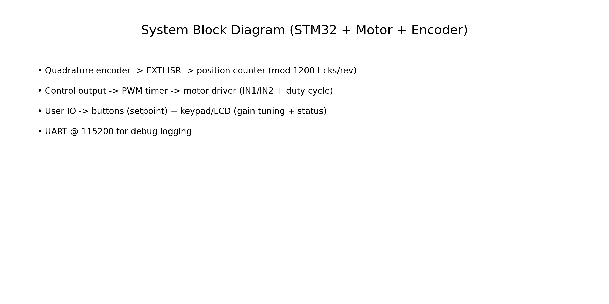

[All projects](./)

In CMU's Introduction to Embedded Systems course (18-349), I built bare-metal and FreeRTOS firmware in C for an STM32 board. Lab 6 brought the drivers together in a motor position controller with a quadrature encoder, a **15 ms PID control loop**, and keypad/LCD tuning.

Course solution code is not distributed here. The hardware kit was returned, so the diagrams and implementation summary below are the available project artifacts.

## Board and driver work

I captured the course-provided schematic and designed the PCB layout myself, then assembled, debugged, and brought up the board using an oscilloscope, multimeter, and bench power supply. The underlying circuit was provided by the course; my design contribution was the layout.

I wrote C drivers for EXTI, timers and PWM, UART, I²C, and ADC to support the keypad, LCD, servo, encoder, and DC motor. The motor-control example below shows how those pieces worked together.

---

## System architecture

### Hardware / IO (from implementation)
- **MCU:** STM32 (Cortex‑M) running **FreeRTOS**
- **Actuation:** DC motor controlled via PWM + direction pins (IN1/IN2)
- **Sensing:** quadrature encoder decoded via EXTI ISR
- **User input:** push buttons for setpoint step, keypad + LCD for tuning
- **Debug:** UART @ **115200** baud

---

## FreeRTOS design (tasks + timing)

**Tasks created (from `lab6_main`)**
- `PIDControl` — main control loop task  
- `pid` — tune P/I/D gains from keypad; show summary on LCD  
- `changeSetpoint` — adjust setpoint via buttons  
- `ledToggle` — heartbeat LED  
- `servoTask` — periodic servo movement (test/demo support)

**Key timing parameters**
- PID sample time: **15 ms** (`PID_SAMPLE_TIME_MS = 15`)
- Heartbeat LED: **250 ms**
- Button polling: **200 ms**
- LCD refresh: **1000 ms**

---

## Control loop details
The PID loop reads the encoder position and computes a drive command with configured duty-cycle bounds. Those bounds limit the commanded output; they are not evidence of a validated motor-protection system.

**What I implemented**
- **Encoder position** tracked modulo **1200 ticks/rev**
- **Shortest-path error** with wrap-around handling (so error doesn’t “jump” across 0/rev boundary)
- Output clamping (duty cycle bounds):
  - `MIN_MOTOR_SPEED = 14`
  - `MAX_MOTOR_SPEED = 90`
- “Close enough” stop condition (deadband): if `|error| <= 30` ticks, motor stops

**Setpoint stepping**
- Buttons step setpoint by **±200 ticks** (≈ 60° per step if 1200 ticks/rev)

---

## Interactive tuning (keypad + LCD)
I implemented a small UI loop to tune PID gains live:
- Prompt for **P**, **I**, **D** sequentially on LCD
- Read digits from keypad
- Update shared gain variables inside critical sections
- Display a summary line with the current tuned values

This makes iteration fast: tune → observe response → tune again, without rebuilding firmware.

---

## What I’d improve next
- Move PID timing to a periodic timer/notification (avoid delays *inside* the PID update function)
- Add a simple serial “telemetry frame” (position, setpoint, drive) to plot step response quickly
- Add explicit anti-windup strategy tied to output saturation

---

The 15 ms value is the configured control period. No measured jitter or step-response dataset is published on this page.
